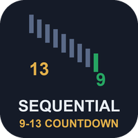
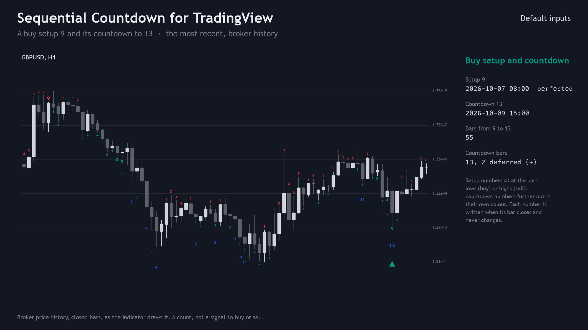
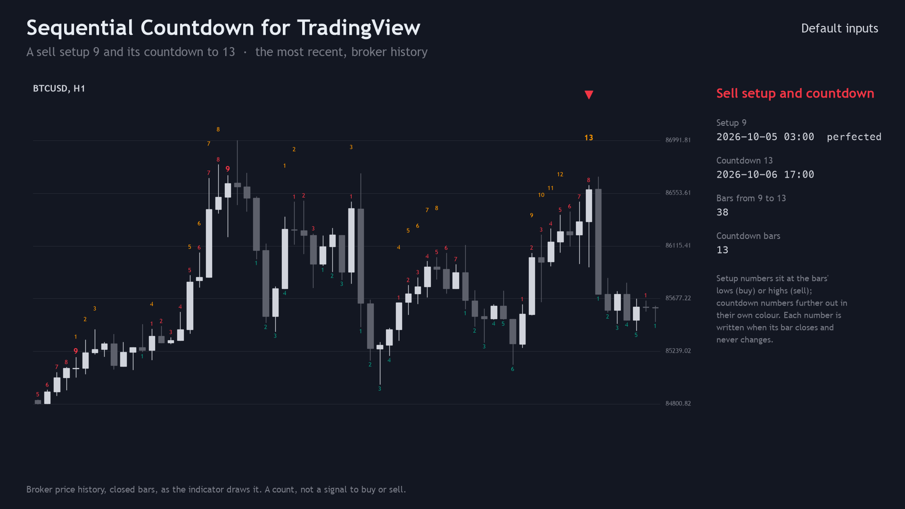
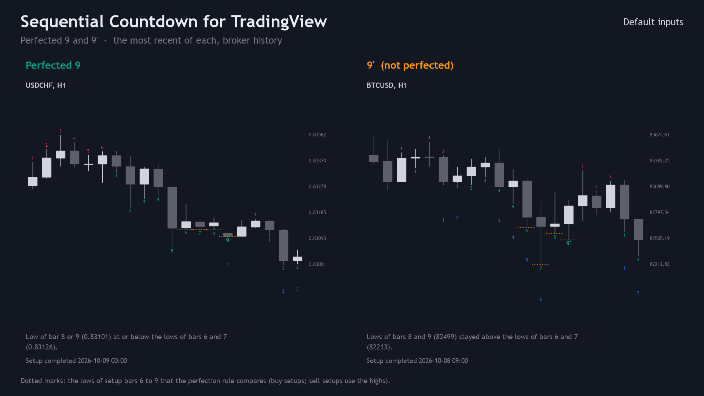
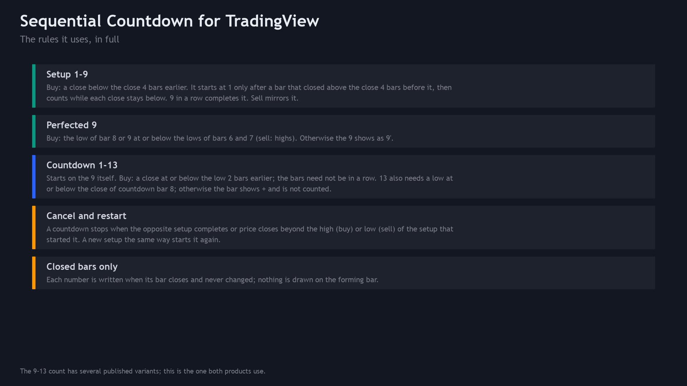
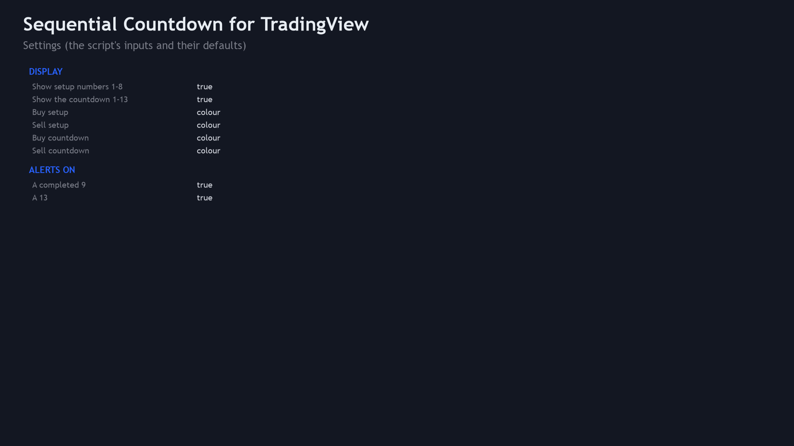
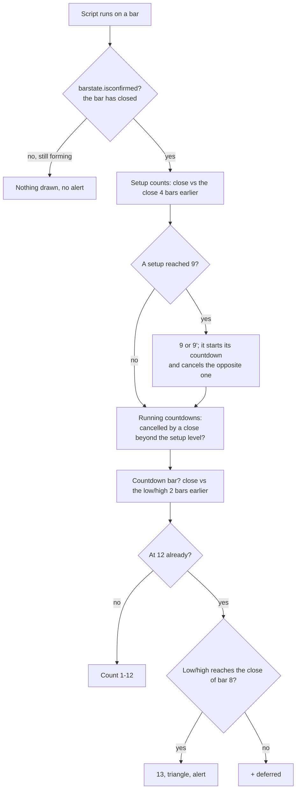
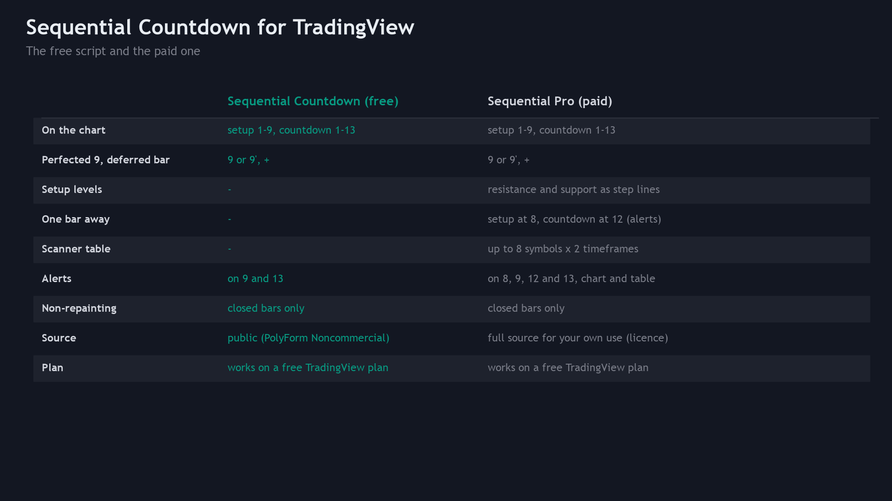

<p align="center"></p>

# Sequential Countdown for TradingView (Pine Script v6)

A free TradingView indicator that writes the **9-13 sequential count** on the chart: setup numbers 1-9 (a perfected
9 shows as `9`, one that is not as `9'`) and countdown numbers 1-13 (`+` for a bar deferred at 12), **on closed bars
only**, with alerts on a completed 9 and a 13. Pine Script v6 source, a Python reference of the rules, and the test
that checks the script against the reference bar by bar.

**Website:** [allanninal.dev](https://www.allanninal.dev) · MetaTrader editions: [allanninal.dev/mql5 (indicators)](https://www.allanninal.dev/mql5/#indicators)
· **Contact:** message me on [LinkedIn](https://www.linkedin.com/in/allanninal/).



> It is an indicator, not a strategy. It writes numbers and places no trades. Nothing here is a profit claim
> (see [Honest limits](#honest-limits)).

## Contents

1. [Install in the Pine Editor](#install-in-the-pine-editor)
2. [What it is and who it is for](#what-it-is-and-who-it-is-for)
3. [How it works](#how-it-works)
4. [Non-repainting](#non-repainting)
5. [Inputs and alerts](#inputs-and-alerts)
6. [Tests](#tests)
7. [Honest limits](#honest-limits)
8. [Free vs Pro](#free-vs-pro)
9. [Licence](#licence)

## Install in the Pine Editor

Works on every TradingView plan, including the free Basic plan. The script is not published on TradingView; you add it
from this source.

1. Open [`pine/SequentialCountdown.pine`](pine/SequentialCountdown.pine) and copy the whole file (the "Raw" button,
   then select all).
2. On a TradingView chart, open the **Pine Editor** tab at the bottom, create a new indicator and replace its text with
   the copied code.
3. Click **Save**, then **Add to chart**. The indicator appears as "Seq Countdown" and is kept in your own scripts.

To get alerts: right-click the chart, **Add alert**, choose **Sequential Countdown** as the condition and then either
**Any alert() function call** (one message per closed bar that names the 9 and the 13 it completed) or one of **Buy
setup 9**, **Sell setup 9**, **Buy countdown 13**, **Sell countdown 13**. Free plans limit how many alerts can be
active at once.

## What it is and who it is for

**What:** the public 9-13 setup-and-countdown method in one stated variant (below), counted by fixed rules. Buy
numbers sit below the bars, sell numbers above; countdown numbers sit a step further out in their own colour, and a
13 also gets a triangle.

**For:** traders who already read sequential counts and want them written on any TradingView chart, with a definition
they can read and check.

**Not for:** anyone who expects a 9 or a 13 to predict a turn. A count describes how closes compared with earlier
closes; it says nothing certain about the next bar.

| | |
|---|---|
|  |  |
|  |  |

Image notes: the charts are drawn from the Python reference on broker price history, which the script matches bar for
bar (see [Tests](#tests)); each example is the most recent case of its kind in a fixed symbol list, not the best
looking one. The rules and settings sheets are illustrations, not TradingView captures.

## How it works

`C[k]`, `H[k]`, `L[k]` are the close, high and low of bar `k`, the bar that just closed.

### Setup 1-9

| | Buy setup | Sell setup |
|---|---|---|
| Setup bar | `C[k] < C[k-4]` | `C[k] > C[k-4]` |
| Starts at 1 only after a flip | `C[k-1] > C[k-5]` | `C[k-1] < C[k-5]` |
| Counting | 2, 3 ... while each bar is a setup bar; any other bar resets the count to 0 | the same |
| Complete | at 9; the count resets, so a new setup needs a new flip | the same |
| Perfected 9 | `min(L[8], L[9]) <= min(L[6], L[7])` (lows of setup bars) | `max(H[8], H[9]) >= max(H[6], H[7])` |
| Setup level | resistance = highest high of the 9 bars | support = lowest low of the 9 bars |

### Countdown 1-13

| | Buy countdown | Sell countdown |
|---|---|---|
| Starts | on the bar of a completed buy setup 9 (a new buy setup restarts it) | on a completed sell setup 9 |
| Countdown bar | `C[k] <= L[k-2]`; the bars need not be in a row | `C[k] >= H[k-2]` |
| 13 | also needs `L[k] <= C` of countdown bar 8; a bar that meets the close rule but not this one shows `+` and is not counted | `H[k] >= C` of countdown bar 8 |
| Cancelled | by a completed sell setup, or a close above the resistance of the setup that started it | by a completed buy setup, or a close below its setup's support |

The same rules, step for step, are used by the MetaTrader editions
([allanninal/sequential-countdown](https://github.com/allanninal/sequential-countdown)).

### Per-bar flow



### How often it fires

On broker history in the MetaTrader editions' check (2023-2026), an H1 chart gets about **13 nines and 3 thirteens per
symbol per month**; on D1 it is under one 9 per month. That counts marks only and says nothing about what price does
afterwards.

## Non-repainting

- Every number, triangle and alert is gated by `barstate.isconfirmed`: nothing is decided on the forming bar.
- Each decision reads only the bar that closed and earlier bars (closes 4 and 5 bars back, lows and highs 2 bars back,
  the setup's 9 bars). No `request.security`, no future bars.
- Alerts use `alert.freq_once_per_bar_close`, so a count that appears and vanishes inside a bar never sends anything.

This was tested, not only reasoned about: see [Tests](#tests).

## Inputs and alerts

| Input | Default | Meaning |
|---|---|---|
| Show setup numbers 1-8 | on | Off: only the 9 that completes a setup is written |
| Show the countdown 1-13 | on | The countdown numbers, `+` for a deferred bar |
| Buy setup, Sell setup | `#089981`, `#F23645` | Setup colours (TradingView's own candle colours by default) |
| Buy countdown, Sell countdown | `#2962FF`, `#FF9800` | Countdown colours |
| A completed 9 | on | Alert when a setup reaches 9 |
| A 13 | on | Alert when a countdown reaches 13 |

Every input has a tooltip in the settings dialog. Four hidden plots show in the Data Window with the same values as the
MetaTrader buffers: "Buy/Sell setup count (9 = complete, 10 = perfected 9)" and "Buy/Sell countdown number (-1 =
deferred)". The tests read them.

| Alert condition | Message |
|---|---|
| Any alert() function call | `Buy setup 9 (perfected) on EURUSD 60; Sell countdown 13 on EURUSD 60` (what the bar completed) |
| Buy setup 9, Sell setup 9 | `Buy setup 9 on {{ticker}} {{interval}}` |
| Buy countdown 13, Sell countdown 13 | `Buy countdown 13 on {{ticker}} {{interval}}` |

## Tests

Run on this exact code:

| Check | Result |
|---|---|
| Compile (TradingView's Pine v6 compiler) | 0 errors, 0 warnings |
| Parity: script vs [`tests/reference.py`](tests/reference.py), every bar, 4 count plots | 0 mismatches: 1,568 nines and 379 thirteens, 12 series, 60,000 bars (default inputs, and both number switches off) |
| Repaint: re-run on the series cut at 3 points, closed bars compared with the full run | 0 of 585,552 closed-bar values changed |

Data: the latest 5,000 closed bars of EURUSD, GBPJPY, XAUUSD and BTCUSD on M15, H1 and H4 (12 series, broker history),
with the default inputs and with both number switches off. The script runs locally in
[PineTS](https://github.com/LuxAlgo/PineTS), an independent Pine v6 runtime. To repeat it on your own bars:

```bash
cd tests/runner && npm install && cd ../..          # PineTS (AGPL-3.0), installed for testing only
python3 -m venv .venv && . .venv/bin/activate && pip install -r requirements.txt
python3 tests/check_pine.py <folder of SYMBOL_TF.csv files: time (unix ms), open, high, low, close>
```

It prints the mismatches per configuration, the repaint count and `ALL PASS` or `FAIL`. The price files used for the
numbers above are not in this repository (they are broker price data).

## Honest limits

- **A count is not a strategy.** No stop-loss, position sizing or exit rules are provided or implied, and the rules
  were not optimised or back-tested for profit. No edge is claimed anywhere.
- **One variant.** The 9-13 count has several published variants (different flip, perfection, cancel and recycle
  rules); this is the one stated above. Other tools will number some bars differently.
- **Where the count starts.** The count runs from the first bar TradingView loads. Two charts with different amounts
  of history (or a MetaTrader chart counting its last 1,500 bars) can differ on the earliest setups and on a countdown
  that was already running when one of them starts. Once both have counted a completed buy setup and a completed sell
  setup, every later number is the same.
- **Plot budget.** Each number is its own `plotshape` (TradingView allows 64 plots per script); they cover all loaded
  bars, with no label cap.
- **Scope of the tests.** PineTS is a separate runtime from TradingView's; the script was compile-checked with
  TradingView's compiler, and its counts were matched in PineTS on the 12 series above. Other symbols, timeframes and
  data feeds are not covered by these numbers.

## Free vs Pro

| | Free: Sequential Countdown | Paid: Sequential Pro |
|---|---|---|
| Setup 1-9 and countdown 1-13 on the chart | yes | yes |
| Perfected 9, deferred `+` | yes | yes |
| Alerts on 9 and 13 | yes | yes |
| Setup resistance and support lines | no | yes |
| Alerts one bar early (setup at 8, countdown at 12) | no | yes |
| Table of the count on several symbols and timeframes | no | yes |
| Closed bars only, no repaint | yes | yes |
| Source | this repository (PolyForm Noncommercial) | delivered to the buyer, personal-use licence |
| Price | free | paid, one-time |

No need to buy the paid script to use this one: the free indicator is complete on its own. Sequential Pro is
described at [allanninal.dev](https://www.allanninal.dev) (page coming soon).



## Licence

Copyright 2026 Allan Niñal (<https://www.allanninal.dev>). Licensed under the
[PolyForm Noncommercial License 1.0.0](LICENSES/PolyForm-Noncommercial-1.0.0.md): source-available, free for personal
and other noncommercial use, not for commercial use. Text: [`LICENSE`](LICENSE). Please do not republish this script on
TradingView or elsewhere as your own. The 9-13 count is a public method; the code is original. Trading involves risk;
the software is provided as is.

---

**Website:** [allanninal.dev](https://www.allanninal.dev) · [MetaTrader editions](https://www.allanninal.dev/mql5/#indicators)
· Questions: message me on [LinkedIn](https://www.linkedin.com/in/allanninal/).
